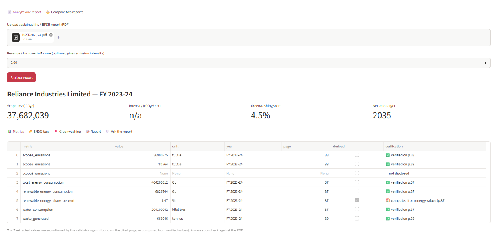
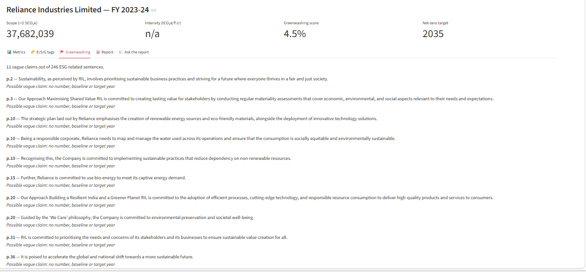
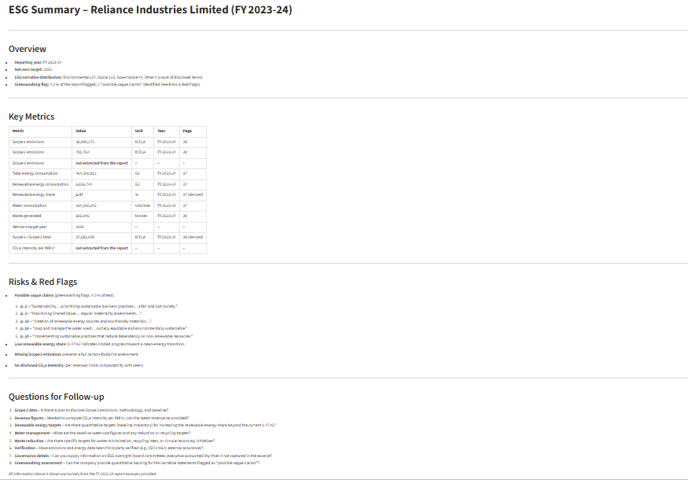
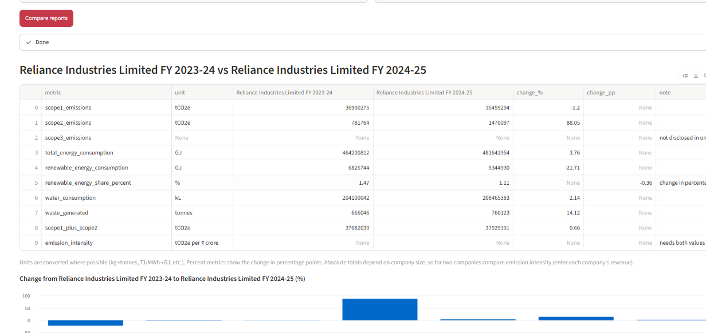

# 🌱 ESGLens AI — Agentic ESG Report Analyzer

Upload an Indian **BRSR / sustainability report (PDF)**. AI agents extract the key ESG numbers, **verify every value
against the page it came from**, flag vague "greenwashing" claims, classify content into E/S/G, compare reports,
and answer questions with page citations.

**Live demo:** _add your Streamlit link here_
## Screenshots




## Features
| Feature | What it does |
|---|---|
| Agentic extraction | LangGraph workflow: retrieve → extract (LLM, JSON) → **validate → retry** → analyze → report |
| Verification badges | Each value shows ✅ verified on page N / ⚠️ not confirmed / — not disclosed |
| Multi-year & company comparison | Upload two reports → side-by-side table, % change, chart (flags unit mismatches) |
| Greenwashing detector | Finds ESG claims with no number, baseline or target year |
| E/S/G classifier | TF-IDF + Logistic Regression tags every chunk |
| Emission intensity | Scope 1+2 per ₹ crore of turnover |
| RAG Q&A | Ask questions, get answers with page citations |
| REST API | `POST /analyze` so n8n / scripts can automate report processing |

## Architecture
```
PDF → parse/clean (pypdf) → chunk (LangChain) → embed → ChromaDB (vector DB)
        LangGraph:  retrieve → extract → validate ──(issues)──► extract (retry once)
                                            └──(ok)──► analyze → report
 analyze = E/S/G classifier (scikit-learn) + greenwashing rules + emission intensity
```
Stack: Python, LangChain, LangGraph, ChromaDB, Groq cloud LLM API, scikit-learn, Pandas, Pydantic, FastAPI, Streamlit.

## Results (hand-verified)
Reliance Industries BRSR FY 2024-25: **8 of 8 checked fields correct** (company/year, Scope 1, Scope 2, energy,
renewable share (derived), water, waste, net-zero year). One report only — more testing needed.

| Report | Fields checked | Correct | Notes |
|---|---|---|---|
| Reliance FY24-25 | 8 | 8 | |
| Reliance FY23-24 | 6 | 6 | matched the prior-year column of the FY24-25 report |

## Run locally
```bash
python -m venv venv
venv\Scripts\activate            # Mac/Linux: source venv/bin/activate
pip install -r requirements.txt
copy .env.example .env           # add your free Groq key (console.groq.com)
streamlit run app/main.py
```
API: `uvicorn api:app --port 8000` then `POST /analyze` (multipart `file`, optional `revenue_inr_crore`).

## Automation with n8n (optional)
Nodes: **Schedule/Drive Trigger → Read PDF → HTTP Request (POST http://localhost:8000/analyze, multipart, field `file`) → Send Email** with `report_markdown`.

## Deploy (Streamlit Community Cloud)
1. Push this repo to GitHub (never commit `.env`).
2. share.streamlit.io → New app → pick repo, branch `main`, file `app/main.py`.
3. Advanced settings → **Python 3.12**, and paste your key in **Secrets**:
   `GROQ_API_KEY = "..."`. Visitors use a shared key with a per-session limit, or their own key.

## Limitations
- Checks that a number appears on the cited page, not that it sits under the right row label.
- E/S/G classifier is trained on a small seed set — add rows to `data/labeled.csv` to improve it.
- Scanned (image-only) PDFs are not supported. Scope 3 is often not disclosed in BRSR.
- LLM output can vary between runs; always spot-check against the PDF.
